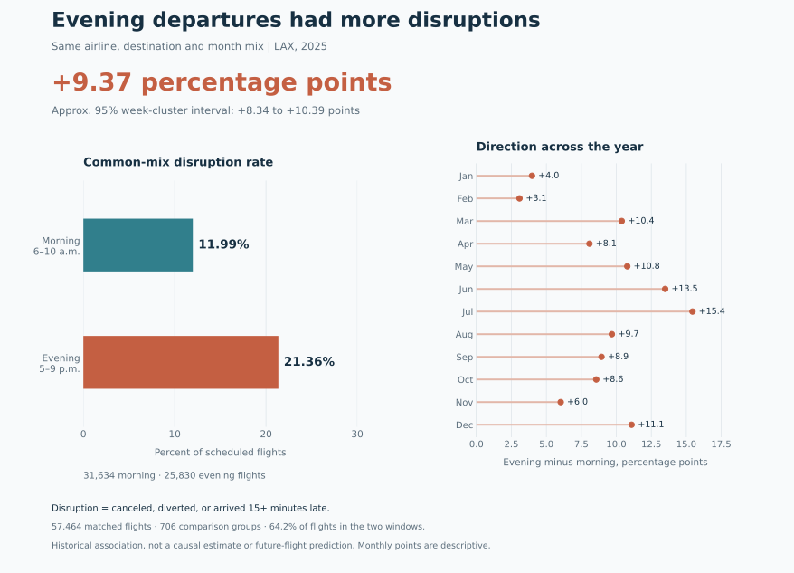

# LAX Flight Reliability

**A data analysis project by John Heerema**

For a given destination, how does flight reliability vary by airline, departure time, and season—and which patterns are dependable enough to inform planning?

**Status:** The matched comparisons, destination/severity follow-up, and Tableau input tables are complete. The first interactive Tableau worksheet is verified; gap/uncertainty summaries, destination views, and final dashboard/story review are next.

**Visualization platform:** The final dashboard or story will be built in **Tableau**. Validated [Tableau CSV sources](docs/tableau_data_guide.md) now support overall results, destination comparisons, and correctly weighted filtered views.

**First finding:** In comparable 2025 airline/destination/month groups, the disruption rate was **11.99%** for morning departures versus **21.36%** for evening departures: a **9.37-percentage-point gap** (approximate 95% week-cluster interval: **8.34–10.39 points**).

Disruption means cancellation, diversion, or arrival at least 15 minutes late. The comparison covers **57,464 flights**, or **64.2% of flights in the selected windows**. It describes a historical association, not a causal effect or future-flight forecast.

Read the [comparison and sensitivity checks](reports/morning_evening.md), including the [plan committed before the estimates](docs/morning_evening_plan.md).



**Dataset checkpoint:** [190,472 LAX departures across all 365 days](reports/year_2025.md), with 12 reporting airline codes and 105 destination airports. Every month and the combined year pass the record checks. Four comparisons match published DOT figures, including national annual totals and December LAX departures.

**First checkpoint:** Read the [January pilot inspection](reports/pilot_2025_01.md) and explore [12 example flight records](data/samples/lax_2025_01_examples.csv). The pilot preserves cancellations and diversions and checks Python calculations against SQL. These are one-month observations; full-year recommendations will follow validated analysis.

**Data rules:** [How records, missing values, and metric denominators will be handled](docs/data_handling.md). These rules were documented before downloading the remaining months.

## Purpose

Help travelers and operations planners understand historical disruption risk when comparing flights from Los Angeles International Airport (LAX).

The project connects logistics planning with data analysis: define a useful question, check the evidence, compare realistic options, and explain the tradeoffs.

## Data and scope

| Item | Planned scope |
| --- | --- |
| Source | U.S. Department of Transportation, Bureau of Transportation Statistics (BTS) |
| Dataset | Reporting Carrier On-Time Performance (1987–present) |
| Period | January 1–December 31, 2025 |
| Flights | Reported nonstop domestic flights scheduled to depart LAX |
| Unit of analysis | One reported scheduled flight occurrence, including cancellations and diversions |
| Comparisons | Destination, reporting airline, scheduled departure time, and month |

BTS reporting coverage determines which carriers and flights appear. This analysis describes the selected dataset; it does not cover international flights or every airline.

Source documentation:

- [Dataset overview](https://www.transtats.bts.gov/TableInfo.asp?QO_fu146_anzr=b0-gvzr&gnoyr_VQ=FGJ)
- [Field definitions](https://www.transtats.bts.gov/Fields.asp?gnoyr_VQ=FGJ)
- [BTS explanation of on-time performance](https://www.bts.gov/explore-topics-and-geography/topics/airline-time-performance-and-causes-flight-delays)

## Measures

| Measure | Definition |
| --- | --- |
| Flight count | Number of reported scheduled flights in the selected group |
| Cancellation rate | Canceled flights divided by all reported scheduled flights in that group |
| Diversion rate | Diverted flights divided by all reported scheduled flights in that group |
| Arrival delay rate | Flights arriving at least 15 minutes late divided by completed, nondiverted flights with a recorded arrival delay |
| 90th percentile arrival delay | A measure of longer delays: the value at or below which 90% of eligible arrival-delay observations fall; early arrivals count as zero minutes late |
| Arrival disruption, first comparison | Cancellation, diversion, or completed arrival at least 15 minutes late, divided by scheduled flights in the selected comparison group |

Arrival-delay measures exclude canceled and diverted flights. Their rates will be shown alongside arrival delays, and missing arrival records will be reported separately. Each result will state its sample size and denominator.

These definitions have been checked on each month and on the full-year dataset. Any later changes will be documented before interpreting comparisons.

## How results will be validated

- Check the downloaded months, date range, LAX filter, required columns, and possible duplicate flight records.
- Inspect missing values and investigate unusual records before deciding how to handle them.
- Keep cancellations and diversions visible rather than replacing missing arrival times with zero.
- Compare airlines serving the same destination and comparable periods; examine differences in departure-time mix.
- Show flight counts and uncertainty so small samples do not dominate rankings.
- Check whether patterns persist across months. If a predictive model is added, evaluate it on later dates kept separate from model development.
- Reconcile selected results with BTS summaries using matching coverage and metric definitions, and explain any differences.
- Preserve source references, download dates, and runnable analysis so results can be reproduced.

Historical patterns describe associations. They do not establish that changing an airline or departure time causes an improvement, and they do not guarantee future flight performance.

## Roadmap

- [x] Create the repository and define the project.
- [x] Download one month as a pilot and inspect the records.
- [x] Document data-handling rules before extending to the full year.
- [x] Build and validate the full-year LAX dataset.
- [x] Complete the first matched reliability comparison and sensitivity checks.
- [x] Explore destination differences and the 60-minute delay threshold.
- [x] Prepare validated Tableau sources with documented row grains and calculations.
- [x] Author and verify the first native Tableau worksheet with a 15/60-minute selector.
- [ ] Build the Tableau dashboard or story and complete its visual checks.
- [ ] Add reproduction instructions and complete the final review.

## Planned deliverables

- Documented Python and SQL analysis.
- A data dictionary and a report of data-quality checks.
- An interactive dashboard for comparing historical reliability.
- A short report with supported recommendations and limitations.
- Instructions for reproducing the published results.

## Run the January pilot

Use Python 3.12. From a local copy of this repository:

```bash
python3 -m venv .venv
source .venv/bin/activate
python -m pip install -r requirements.txt
python scripts/inspect_pilot.py
```

The activation command above is for macOS/Linux. On Windows, activate the environment with `.venv\Scripts\activate`.

The script downloads the original 27 MB BTS ZIP, reads the national CSV in chunks, retains LAX departures, and writes a local extract to `data/interim/`. It regenerates the pilot report, JSON profile, and illustrative records. Original archives and full extracts stay outside Git; the [source manifest](data/manifests/pilot_2025_01.json) records the download and checksum.

After the first download, repeat the inspection without network access:

```bash
python scripts/inspect_pilot.py --offline
```

Run the focused calendar, filtering, denominator, source-integrity, and reference-matching tests:

```bash
python -m unittest discover -s tests -v
```

## Build the full-year dataset

With the same environment and requirements, run from the repository root:

```bash
python -m scripts.build_year
```

The first run downloads about 355 MB of official monthly ZIPs. The files are read in chunks, and the combined LAX extract is saved locally as `data/interim/lax_2025.csv`. Source checksums, timestamps, and the extract checksum are recorded in the [year manifest](data/manifests/year_2025.json).

To reproduce the build from cached archives:

```bash
python -m scripts.build_year --offline
```

The command regenerates the [validation report](reports/year_2025.md), [JSON audit](reports/year_2025.json), [monthly summary](data/summary/2025_monthly.csv), and [carrier exposure table](data/summary/2025_carrier_month_counts.csv). A [standalone SQL query](sql/monthly_validation.sql) cross-checks monthly counts, and [documented DOT benchmarks](data/reference/dot_2025_benchmarks.json) provide checks against published totals. A failed data or reconciliation check stops the build before published outputs are replaced.

## Reproduce the first comparison

After building the validated year extract, update the pinned requirements and run:

```bash
python -m pip install -r requirements.txt
python -m scripts.compare_departure_windows
python -m unittest discover -s tests -v
```

The analysis verifies the input checksum, applies the precommitted protocol, checks Python's primary result with separate SQL, and regenerates the [report](reports/morning_evening.md), [JSON audit](reports/morning_evening.json), [matched group table](data/summary/morning_evening_pairs.csv), [monthly results](data/summary/morning_evening_monthly.csv), [sensitivity results](data/summary/morning_evening_sensitivity.csv), and standalone SVG figure.

## Prepare the Tableau sources

The [destination/severity follow-up](reports/route_severity.md) compares the 15- and 60-minute definitions on the same matched flights and labels destination coverage and uncertainty. Its [plan](docs/route_severity_plan.md) was committed before the extension estimates.

```bash
python -m scripts.route_severity
```

The command regenerates the [overall](data/tableau/overall_comparison_2025.csv), [destination](data/tableau/destination_comparison_2025.csv), and [pair-level](data/tableau/comparison_pairs_2025.csv) CSVs, their [dictionary](data/tableau/data_dictionary.csv), a [checksum manifest](data/manifests/tableau_sources_2025.json), and the [follow-up audit](reports/route_severity.json). The [Tableau guide](docs/tableau_data_guide.md) starts with one small connection and documents the correct aggregation rules.

## Inspect the native Tableau checkpoint

The [packaged workbook](tableau/checkpoints/LAX_Flight_Reliability_Checkpoint_01.twbx) is an authoring checkpoint, containing the overall comparison and its embedded data. The [audit](reports/tableau_checkpoint_01.md) checks its data against the validated CSV and inspects the saved filter, title, aggregation, axis, colors, and bar order.

To repeat the inspection without downloading the raw flight archives:

```bash
python -m pip install -r requirements-tableau.txt
python -m scripts.inspect_tableau_workbook
```

The command regenerates the [machine-readable audit](reports/tableau_checkpoint_01.json). It reads a temporary copy of the embedded extract and leaves the packaged workbook unchanged. It verifies data and configuration; screenshots and in-app interactions are checked separately during authoring.

## AI assistance

AI assists with code drafting, debugging, analysis ideas, and explanations. Every published finding must trace to source data, executed code, and documented checks. Methods and conclusions will be reviewed as the project develops.

## License

Project code is available under the [MIT License](LICENSE). BTS remains the source of the flight data; this project does not relicense the source data.
