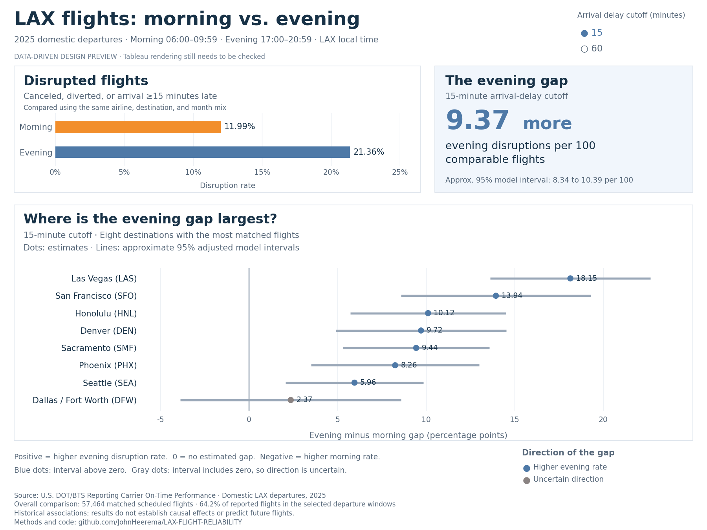
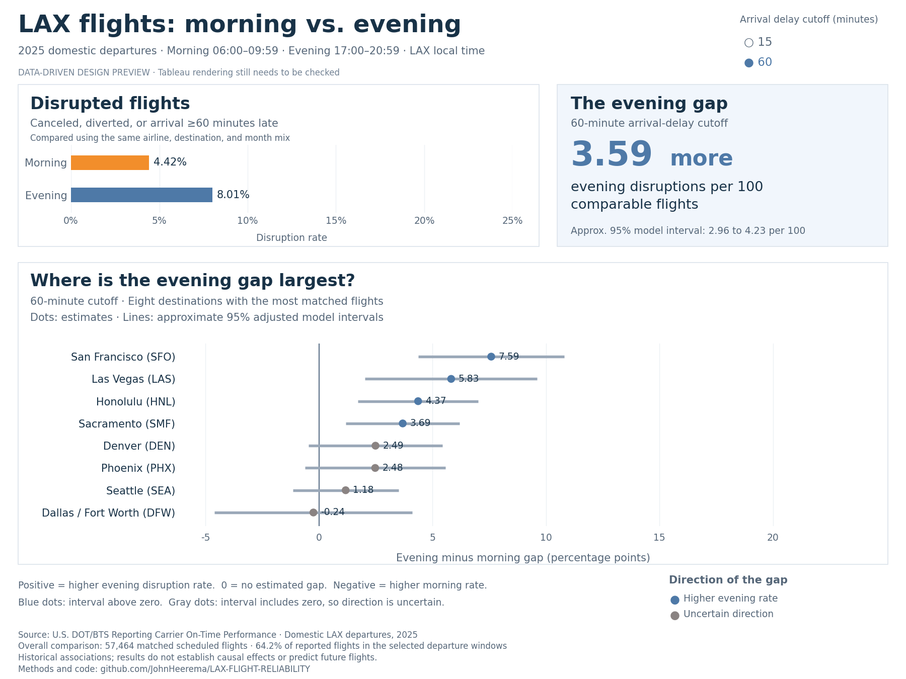

# Tableau dashboard redesign candidate

**Status: editable candidate; not yet rendered or published in Tableau.**

The [current public dashboard](https://public.tableau.com/app/profile/john.heerema/viz/LAXFlightReliabilityMorningvs_Evening2025/LAXReliabilityOverview) remains the published version. The web editor stalled before publication. The candidate below was produced by editing the native workbook XML; its configuration checks do not establish that Tableau will render every change correctly.

**November 24 loading repair:** the first candidate was rejected by Tableau with error `D2E8DA72`: a `formatted-text` element appeared after `zone-style`. Tableau requires text before the layout/style children in a dashboard zone. The builder now inserts text first, and the workbook has been rebuilt. Regression checks cover insertion, replacement, and rejection of the previous invalid ordering. A successful Tableau open/render of the corrected file still needs confirmation.

[Download the redesigned packaged workbook](../tableau/LAX_Flight_Reliability_Redesigned.twbx) · [Configuration audit](../reports/tableau_redesign.json)

## What changed

- A fixed 1200 × 900 desktop layout groups the overall rate chart beside the main finding.
- The headline gap reads as additional evening disruptions per 100 comparable flights, with its model interval immediately below.
- The rate chart retains orange for morning and blue for evening, and explains the shared airline, destination, and month mix.
- Destination labels include city names and airport codes. Rows sort from the largest estimated evening gap down, within the same eight destinations chosen by matched flight count.
- Both cutoff states use a shared destination scale, with every displayed interval endpoint inside its bounds.
- Stronger interval lines, explanatory notes, and detailed destination tooltips help distinguish the estimate from uncertainty. Gray dots retain the original uncertain-direction meaning.
- The shared cutoff control, live titles, comparison filters, source notes, coverage, and historical-association limitation remain in the workbook.

The candidate is a desktop layout. Its old automatically generated phone layout was removed; a mobile layout has not been designed or checked.

## Data-driven previews

These PNGs are drawn from the validated Tableau CSVs using Matplotlib. They illustrate the intended design and values. **They are not screenshots of the redesigned workbook rendered by Tableau.** Font metrics, wrapping, marks, axis treatment, and exact spacing can differ in Tableau.

### 15-minute cutoff



### 60-minute cutoff



## Verification completed

The candidate passes **49 data/configuration checks**, including required text ordering, preserved source connections, calculations, filters, aggregations, threshold mappings, units, live text bindings, city aliases, color mappings, and interval bounds. The original final archive was freshly rechecked against its pinned **82-check** audit.

Both embedded Hyper extracts are byte-identical to the verified original, preserving all **2,062 embedded values**. The analysis, canonical CSVs, original final workbook, and previous audits were not modified. The complete project test suite passes **66 tests**, including deliberate-failure checks for altered extract bytes, conflicting cutoffs, clipped intervals, and invalid text ordering.

These checks verify data and saved configuration. They do not replace a native Tableau open/render check, live tooltip inspection, or testing the shared filter after Tableau loads the candidate.

## Next check in Tableau

1. Open `LAX_Flight_Reliability_Redesigned.twbx` in Tableau Desktop or Tableau Public Desktop.
2. Select **LAX Reliability Overview**. Check for missing fields, clipped text, overlapping objects, visible interval lines, city labels, and a single 15/60 cutoff control.
3. Switch between both cutoffs. At 15 minutes, the rates should read **11.99% / 21.36%** and the gap **9.37**. At 60 minutes, they should read **4.42% / 8.01%** and **3.59**. All three views and their titles should change together.
4. Hover over a destination dot and interval. Check the gap, adjusted bounds, both rates, and flight counts. At 60 minutes, SFO, LAS, HNL, and SMF should be blue; the other four displayed destinations should be gray.
5. Resolve any rendering issues before replacing the published workbook. Reopen the published view and repeat both cutoff checks after publication.

## Rebuild and audit

From the repository root, with the pinned project and Tableau dependencies installed:

```bash
python -m scripts.redesign_tableau_workbook
python -m scripts.inspect_tableau_redesign
python -m scripts.preview_tableau_redesign
python -m unittest discover -s tests -v
```

The builder starts from the archived final workbook and preserves its embedded extracts. It preserves ZIP timestamps so repeated builds in the same environment produce the same workbook bytes. Native Tableau rendering remains an explicit outstanding check.
