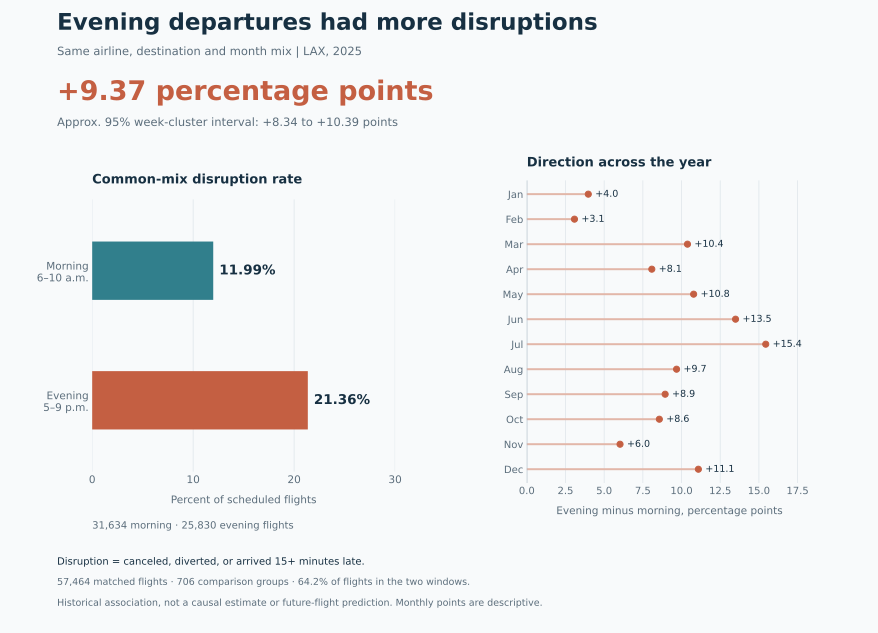

# Morning and evening departures: the same airline, destination and month mix

**Finding:** Among the supported comparisons, evening flights had a **9.37-percentage-point higher arrival-disruption rate**. The common-mix rates were **11.99% in the morning** and **21.36% in the evening**. The approximate 95% week-cluster interval for evening minus morning is **+8.34 to +10.39 points**.

This is a historical association in the covered 2025 flights. The interval is conditional on the comparison design and its dependence assumptions, not a prediction interval for a future flight.

For scale, the standardized gap corresponds to about **94 more disruptions per 1,000 scheduled flights** at that common mix.



## What was compared

Morning means scheduled departure **06:00–09:59**, and evening means **17:00–20:59**, in LAX local time. A disruption is a **cancellation, diversion, or completed arrival at least 15 minutes late**. Its denominator includes all scheduled flights in the selected group; ordinary arrival-delay blanks are preserved.

Each comparison group uses the **same reporting operating-carrier DOT ID, destination airport ID, and month**, with at least 10 morning and 10 evening flights. We calculate both window rates inside each group, then give both windows the same weights based on that group's combined scheduled flights. This creates a common airline/destination/month mix.

The [analysis plan](../docs/morning_evening_plan.md) and [executable protocol](../analysis/morning_evening_protocol.json) were [committed before the outcome comparisons were calculated](https://github.com/JohnHeerema/LAX-FLIGHT-RELIABILITY/commit/30d7bfcbf696a162db70506ff1f668fc9bd8794c). The primary specification was kept after inspecting its results.

## How much of the dataset supports this comparison?

| Coverage step | Flights |
| --- | ---: |
| Full validated LAX dataset | 190,472 |
| Scheduled outside the two selected windows | 101,015 |
| All flights inside the two windows | 89,457 |
| Inside the windows but without supported comparisons | 31,993 |
| **Retained in the primary comparison** | **57,464** |

The retained flights comprise **31,634 morning** and **25,830 evening** departures, across **706 airline/destination/month groups**, **10 reporting airline codes**, and **46 destinations**. They represent **64.2% of flights in the selected windows**. These exclusions concern this comparison only; the full dataset remains intact.

The remaining windows or routes may have a different relationship. The result should not be described as the difference for every LAX flight or every destination.

## Raw and common-mix comparisons

| Comparison | Morning | Evening | Evening minus morning |
| --- | ---: | ---: | ---: |
| All flights in the two windows, unadjusted | 13.37% | 21.40% | +8.03 points |
| Retained comparable flights, unadjusted | 12.15% | 21.48% | +9.32 points |
| **Retained flights, common airline/destination/month mix** | **11.99%** | **21.36%** | **+9.37 points** |

The change between the first two rows reflects which flights have supported counterparts. The change between the second and third rows is the reweighting to a common airline/destination/month mix. Those are separate steps; the entire change from the first to the third row should not be attributed to adjustment alone.

## What drives the gap?

These are common-mix component rates **per scheduled flight**, using the same groups and weights as the main result.

| Component | Morning | Evening | Evening minus morning |
| --- | ---: | ---: | ---: |
| Canceled | 0.67% | 0.69% | +0.03 points |
| Diverted | 0.24% | 0.10% | -0.14 points |
| Completed arrival 15+ minutes late | 11.08% | 20.57% | +9.48 points |

The observed difference is dominated by late completed arrivals; the cancellation component is much smaller. Diversion rates differ in the opposite direction. These components add to the composite before rounding. They describe observed rates, without establishing equivalence or statistical differences for each component individually.

The earlier conditional arrival-delay measure in the dataset report has a different denominator: completed, nondiverted arrivals. The component above instead divides late completed arrivals by all scheduled flights, so it can add correctly to cancellations and diversions.

## Does the pattern depend on one month?

The evening-minus-morning common-mix difference is positive in **12 of 12 months**. Each month uses its own supported groups and common weights.

| Month | Morning | Evening | Difference | Retained flights |
| --- | ---: | ---: | ---: | ---: |
| 2025-01 | 10.82% | 14.79% | +3.97 points | 4,316 |
| 2025-02 | 12.77% | 15.85% | +3.08 points | 4,282 |
| 2025-03 | 9.90% | 20.29% | +10.38 points | 4,749 |
| 2025-04 | 10.09% | 18.17% | +8.08 points | 4,661 |
| 2025-05 | 10.25% | 21.04% | +10.78 points | 5,246 |
| 2025-06 | 11.61% | 25.10% | +13.49 points | 5,159 |
| 2025-07 | 12.83% | 28.27% | +15.44 points | 5,403 |
| 2025-08 | 11.66% | 21.34% | +9.68 points | 5,231 |
| 2025-09 | 9.73% | 18.68% | +8.94 points | 4,499 |
| 2025-10 | 11.57% | 20.14% | +8.57 points | 4,694 |
| 2025-11 | 18.48% | 24.51% | +6.03 points | 4,335 |
| 2025-12 | 14.58% | 25.67% | +11.09 points | 4,889 |

Monthly points are descriptive; they do not constitute 12 separately confirmed causal effects. The annual result uses pooled-flight weights across months, rather than an unweighted average of monthly rates or gaps.

## Sensitivity checks specified in advance

| Specification | Retained flights | Share of window flights | Gap, points | Approx. 95% interval, points |
| --- | ---: | ---: | ---: | --- |
| Minimum 5 per window | 59,980 | 67.0% | +9.33 | +8.33 to +10.33 |
| Minimum 20 per window | 52,118 | 58.3% | +9.52 | +8.47 to +10.58 |
| Also match weekday; minimum 3 | 53,577 | 59.9% | +9.47 | +8.40 to +10.54 |
| Primary groups, two-week uncertainty clusters | 57,464 | 64.2% | +9.37 | +8.25 to +10.49 |

The weekday check compares flights with matching scheduled weekdays as well as airline, destination, and month. The support checks change the comparison population; the two-week check keeps the primary population and point estimate, changing the uncertainty calculation only. All specified results are shown, without choosing a replacement main result after seeing them.

## How uncertainty was calculated

The primary interval groups residual contributions by **53 calendar-week clusters**, allowing flights in a week to share operational conditions. It uses a CR1 finite-sample correction and a Student t critical value with **52 degrees of freedom**. It treats the observed group weights and comparison design as fixed. The exact scalar calculation and correction are explained in the [plan](../docs/morning_evening_plan.md).

The dataset contains the recorded flights for 2025. The interval concerns an approximate model of operational variability; the observed historical rates themselves are known for this dataset. Independence across weekly clusters is assumed. The two-week sensitivity considers longer shared conditions but does not prove that all remaining dependence is absent. Unmeasured differences can still explain part of the association.

## Checks supporting this result

The input matches the validated extract checksum. A [separate SQL query](../sql/morning_evening.sql) reassigns time windows from raw HHMM codes, rebuilds the composite from raw outcome fields, and recalculates grouping, counts, and common-mix rates. Its point estimates agree with Python to an absolute tolerance of 1e-12.

Focused tests include a hand-calculated reversal of raw versus common-mix rates, a separate saturated-regression matrix covariance calculation, time-window boundaries, support rules, preserved missing arrivals, and an SQL check that ignores Python's derived outcome and window labels.

| Analysis check | Result |
| --- | --- |
| Common group weights are positive and sum to one | PASS |
| Both windows meet the predeclared support rule | PASS |
| Retained flight counts reconcile | PASS |
| Morning disruption components reconcile | PASS |
| Evening disruption components reconcile | PASS |
| All 12 months support the primary comparison | PASS |
| Monthly morning_rate reconciles to the annual contrast | PASS |
| Monthly evening_rate reconciles to the annual contrast | PASS |
| Monthly difference reconciles to the annual contrast | PASS |
| Longer clustering changes uncertainty, not the primary point estimate | PASS |

The [JSON audit](morning_evening.json) stores full-precision results, input/protocol checksums, the protocol commit, coverage, sensitivities, and validation. The [matched group table](../data/summary/morning_evening_pairs.csv) supports numerical review; small groups in that file are not standalone route recommendations.

## What a planner can use, and what remains unknown

The comparison supports treating departure time as a useful historical reliability consideration when evaluating otherwise practical options. It supports reviewing morning availability for a time-sensitive trip while still checking the particular airline, route, weekday, price, and current schedule. It does not establish that moving a flight's departure time would itself cause the observed improvement.

This analysis does not identify the operational mechanism, estimate financial savings, guarantee future performance, or establish a preferred time for every route. A route-specific view and a simple dashboard are the next steps toward a usable planning tool.

## Reproduce the analysis

Install the pinned requirements and build the validated year extract, then run:

```bash
python -m scripts.compare_departure_windows
python -m unittest discover -s tests -v
```

The command needs only the cached validated LAX extract. It checks the input checksum and regenerates the report, numerical audit, matched groups, monthly/sensitivity CSVs, and standalone SVG. The PNG under `data/interim/` is a local preview for figure review.
